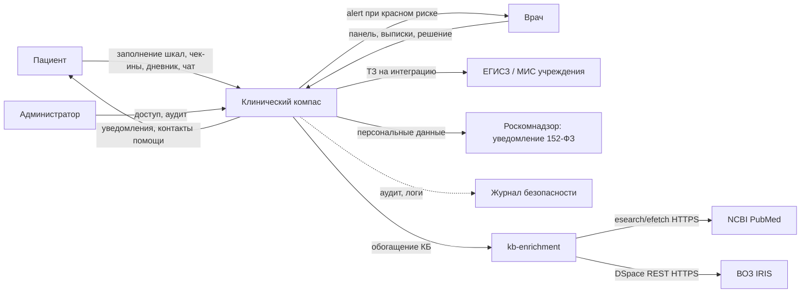

# 02. Системный анализ

Продукт: цифровой инструмент диагностики и ведения пациентов с тревогой и депрессией (рабочее имя — «Клинический компас»)
Статус: v0.1, 2026-10-09. Все [ДОПУЩЕНИЕ] подлежат подтверждению на открытии 15.10.

---

## 1. Акторы и роли

| Актор | Описание | Системные роли (RBAC) |
|---|---|---|
| Пациент | 18+, амбулаторный, лёгкая–средняя тревога/депрессия, на диспансерном наблюдении или самозапись | `PATIENT` |
| Врач | психиатр/психотерапевт, ординатор, ведёт пациента | `CLINICIAN` |
| Администратор | учреждение: управление доступом врачей, журнал аудита | `ADMIN` |
| Система | фоновые процессы: расчёт баллов, эскалации, напоминания | — |
| Симулятор демо | генератор правдоподобных пациентов для демо-дня (не в проде) | `SEED` |

## 2. Сценарии использования (ключевые)

| ID | Сценарий | Актор | Результат |
|---|---|---|---|
| UC-1 | Первичный скрининг | Пациент | заполняет GAD-7/PHQ-9 → балл, интерпретация, триаж-уровень |
| UC-2 | Ежедневный чек-ин | Пациент | короткая сгенерированная анкета (2–5 вопросов) → обновление тренда |
| UC-3 | Эскалация риска | Система | красный флаг (суицидальный пункт/высокий балл) → alert врачу + контакты помощи пациенту |
| UC-4 | Просмотр панели | Врач | список пациентов, сортировка по риску, графики динамики |
| UC-5 | Дневник | Пациент | заметка/настроение/сон → видно врачу в ленте |
| UC-6 | Чат-поддержка | Пациент | скрипты FAQ/горячая линия; эскалация на человека при риске |
| UC-7 | Согласие ПДн | Пациент | подписание согласия (152-ФЗ), отзыв; без него — демо-режим без персональных данных |
| UC-8 | Аудит доступа | Админ | журнал «кто/что/когда» по медицинским данным; экспорт |
| UC-9 | Выписка-отчёт | Врач | сводка по пациенту (шкалы, тренд 30/90 дней, триаж) — для приёма |

## 3. Контекстная диаграмма



## 4. Модель ожидаемой нагрузки

### 4.1 Уровни масштаба

| Параметр | L0: Демо-день | L1: Пилот (1 учреждение) | L2: Сеть клиник (12 мес.) |
|---|---|---|---|
| Пациенты на учёте | 100 (симулятор) | 3 000–5 000 | 50 000 |
| MAU | 100 | 900–1 500 (30% учёта) | 15 000 |
| DAU | 100 | 180–300 (20% MAU) | 3 000 |
| Пик одновременных | 50 | 60–100 | 600–1000 |

[ДОПУЩЕНИЕ] Проценты активности: 30% MAU/учёт, 20% DAU/MAU — типично для companion-приложений с ежедневным чек-ином.

### 4.2 Расчёт API-нагрузки

События/день/пациент: 1 чек-ин (POST), 2–3 чтения (дневник, тренд, уведомления), ~0.2 чат-сообщения → **≈ 4 запроса/день**.

| Уровень | Запросов/день | Средний RPS | Пиковый час (×20 к среднему) | Пиковый burst (×10 к часу) |
|---|---|---|---|---|
| L0 | 400 | 0.005 | 0.1 | 1 |
| L1 (300 DAU) | 1 200 | 0.014 | 0.3 | 3 |
| L2 (3 000 DAU) | 12 000 | 0.14 | 2.8 | 28 |
| L2×5 (=15 000 DAU, запас) | 60 000 | 0.7 | 14 | 140 |

**Вывод**: даже L2×5 даёт < 150 RPS на пике — один инстанс Postgres + лёгкий веб-сервер закрывают с запасом. Тяжёлые компоненты (LLM/TTS) выносятся за горячий путь.

### 4.3 Расчёт хранилища

Размер записи чек-ина ≈ 5 КБ (8 ответов × ~500 Б + метаданные). Аудит-событие ≈ 0.5 КБ, 20 событий/пациент/день → 10 КБ/день/пациент.

| Уровень | Чек-ины/год | Медицинские данные/год | Аудит/год | Итого/год |
|---|---|---|---|---|
| L1 (300 DAU) | 110 тыс. | ~0.6 ГБ | ~1.1 ГБ | **~2 ГБ** |
| L2 (3 000 DAU) | 1.1 млн | ~6 ГБ | ~11 ГБ | **~17 ГБ** |
| L2×5 (15 000 DAU) | 5.5 млн | ~28 ГБ | ~55 ГБ | **~85 ГБ** |

Retention: медданные 5 лет (номенклатура Минздрава), аудит 5 лет → L2: **~85 ГБ–0.5 ТБ**. Вердикт: Postgres + объектное хранилище (медиа/экспорты), индексы по `(patient_id, created_at)`.

### 4.4 Голос (осознанное ограничение)

TTS-озвучивание (пациенту) — не храним ничего, генерим на лету. STT голосовых ответов: аудио 16 кГц/16 бит ≈ 32 КБ/с; при 5% пользователей и 30 с ответа — ~14 МБ/день на L1 (~5 ГБ/год) → **аудио не хранится**: распознаём и удаляем, хранится только транскрипт. Голосовое аудио трактуем **консервативно как биометрию** (152-ФЗ ст. 11; ПП РФ №572 от 30.06.2018 относит голос к биометрии при однозначной идентификации — вопрос спорный, поэтому не храним и не передаём вовне; транскрипт — специальная категория). [TBD: юрист пилота — подтвердить квалификацию]

## 5. Инвентарь хранимых данных

| Данные | Категория ПДн (152-ФЗ) | Срок хранения | Шифрование at rest (фактически) | Доступ |
|---|---|---|---|---|
| Учётка (email, пароль-хеш, роль) | обычные | до отзыва согласия / удаления | пароль — Argon2-хеш; email — plaintext | сам субъект |
| Профиль пациента (ФИО) | обычные (спец- контекст при мед. связи) | до удаления по запросу | plaintext | пациент, врач (привязка), админ-аудит |
| Согласие на обработку ПДн (текст, дата, версия) | обычные (реквизиты ст. 9 ч. 4) | 5 лет после отзыва | plaintext | субъект, админ |
| Признаки здоровья: ответы шкал, баллы, триаж | **специальная категория** (ст. 10) | 5 лет (меддокументация) | plaintext (целые числа/коды); прод — TDE/LUKS | врач (по привязке), пациент (свои) |
| Эскалации/красные флаги | специальная категория | 5 лет | plaintext (флаги/коды); прод — TDE | врач, пациент (свои), аудит |
| Заметки дневника (текст, настроение, сон) | специальная категория (контекст) | 5 лет | **pgcrypto** `pgp_sym_encrypt` (CC_DATA_KEY) | врач, пациент (свои) |
| Сообщения чата | обычные/спец. (по содержанию) | 1–5 лет | **pgcrypto** `pgp_sym_encrypt` (CC_DATA_KEY) | участники диалога |
| Текст НЯ / заметка приверженности | специальная категория | 5 лет | **pgcrypto** `pgp_sym_encrypt` (CC_DATA_KEY) | врач, пациент (свои), аудит |
| Журнал аудита (кто/что/когда) | обычные | 5 лет, WORM-семантика | plaintext (append-only trigger) | админ, орган контроля |
| Транскрипты голоса (без аудио) | специальная категория | 5 лет | не хранится в MVP | врач, пациент |
| Внешние публикации: абстракты статей PubMed, полные тексты гайдлайнов ВОЗ, вердикты критериев и цитаты (`kb_works`) | ПДн нет (научный контент; данные пациентов в PubMed не передаются) | бессрочно, пока источник в КБ; удаляется записью реестра | plaintext; лицензия проверяется до индексации | админ-ревью, врач (опубликованные) |
| Журнал прогонов обогащения (`kb_runs`: запрос, время, версии, статистика, ошибки) | ПДн нет | не регламентирован (демо); очистка вручную | plaintext | админ |
| Персональные исключения источников (`kb_exclusions`: врач → guideline_id) | обычные (факт предпочтения, не диагноз) | до отзыва согласия/удаления врача | plaintext | сам врач, админ-аудит |

> **Гейт пилота (не MVP):** для реальных пациентов согласие на спецкатегорию (ст. 10 ч. 2 п. 1) должно быть **письменным** с обязательными реквизитами ст. 9 ч. 4 (ФИО+документ субъекта, наименование/адрес оператора, цель, перечень ПДн и действий, срок, порядок отзыва, подпись). В MVP (демо-симулятор, `is_demo`) согласие — электронная отметка версии текста; перед пилотом модель дополняется реквизитами и текстом.

> **Фактическое состояние шифрования (F1, security-audit):** свободный текст спецкатегории
> (дневник, чат, НЯ, заметка приверженности) шифруется на уровне приложения через pgcrypto
> `pgp_sym_encrypt`/`pgp_sym_decrypt` (`api/app/crypto.EncryptedText`), ключ `CC_DATA_KEY`
> (параметризованный bind, не в тексте SQL). Остальная спецкатегория (числовые ответы шкал,
> баллы, триаж, эскалации-флаги) хранится plaintext — это целочисленные/категориальные
> значения без свободного текста. **Продакшн-путь до пилота с реальными ПДн:** KMS
> (Yandex/VK Cloud KMS) для `CC_DATA_KEY`, LUKS-том под pgdata, TDE/постоянное шифрование
> БД, отказ от демо-секретов (`CC_PROD_MODE=true` → fail-fast в `config._check_secrets`).
> Демо работает на ноутбуке с одноразовыми данными; реальные ПДн — только на УЗ-2 хостинге в РФ.

Правило минимализации: поля, не нужные для функций MVP, не собираются (никаких «на всякий случай»).

## 6. Логическая структура данных

```
user                — id, email, password_hash, role(PATIENT|CLINICIAN|ADMIN), fio?, totp_secret, created_at
consent             — id, user_id, version, text_hash, signed_at, revoked_at?
questionnaire       — каталог в core/compass/scales.py (не таблица БД): code(PHQ-9|GAD-7|HADS-A|HADS-D), items, пороги
questionnaire_run   — id, patient_id, questionnaire_code, mode(SCREENING|CHECKIN|FOLLOW_UP), started_at, finished_at
answer              — id, run_id, item_key, value, answered_at
assessment          — id, run_id, total_score, severity(NONE|MILD|MODERATE|SEVERE), triage(GREEN|YELLOW|RED),
                      risk_flags_json(суицидальный пункт и пр.), computed_at
escalation          — id, assessment_id, patient_id, kind(SUICIDAL|SEVERE|TREND), notified_clinician_at, resolved_at, resolution
diary_entry         — id, patient_id, content, mood(1-10), sleep_h(0-12), tags[], created_at
chat_message        — id, patient_id, sender(PATIENT|SYSTEM|CLINICIAN), kind(TEXT|FAQ|HOTLINE|LLM), content, created_at
                      (плоский: без сущности chat_thread — поток = все сообщения пациента)*
audit_log           — id, actor_id, action, object_type, object_id, ip, occurred_at  (append-only)
clinician_roster    — id, clinician_id, patient_id, granted_at            (привязка врач→пациенты, управляется админом)
kb_works            — id, source(pubmed|who), external_id(PMID|handle), kind(article|guideline), guideline_id, revision,
                      content_hash, status(candidate|approved|rejected|excluded|superseded), title, full_text,
                      meta, design, criteria(вердикты+цитаты), appraisal, retraction, revision_history,
                      first_seen_at, last_seen_at, published_at?, indexed_hash?, chunk_count, approved_by?, approved_at?,
                      reject_reason?
kb_runs             — id, trigger(schedule|manual|cli), status(running|ok|partial|failed), query_plan, versions,
                      stats, errors, started_at, finished_at?
kb_exclusions       — id, user_id(врач), guideline_id, created_at                (персональный фильтр выдачи)
```

> `*` Модель согласована с реализацией (и DDL в 04 §5): `chat_messages` плоский (patient_id + sender/kind), сущность `chat_thread` в MVP не нужна. Каталог шкал (`questionnaire`) живёт в `core/compass/scales.py`, а не в БД; профиль пациента — столбцы `fio` на `user`, без отдельной таблицы `profiles`.

Ключевые индексы: `assessment(patient_id, computed_at DESC)`, `questionnaire_run(patient_id, finished_at DESC)`, `answer(run_id)`, `audit_log(occurred_at)`, `escalation(patient_id, resolved_at)`.

Инварианты:
- Один активный `questionnaire_run` на пациента в режиме SCREENING; чек-ины — не чаще 1/сутки.
- `assessment.triage` считается **детерминированно** из `total_score` + `risk_flags` (чистая функция — ядро юнит-тестов).
- Данные пациента читает только врач из его `clinician_roster` (проверка на уровне сервиса, не UI).
- `audit_log` — только append, без UPDATE/DELETE в API.

## 7. Регламенты РФ: применимость и требования к дизайну

| НПА / ГОСТ | Что регулирует | Требование к нашей системе |
|---|---|---|
| **152-ФЗ «О персональных данных»** | обработка ПДн; медданные — специальная категория (ст. 10), биометрия (ст. 11), согласие (ст. 9), уведомление РКН (ст. 22) | форма согласия + отзыв (см. гейт §5: при отзыве — прекращение обработки и уничтожение спецкатегорий ≤30 дн., ст. 9 ч. 2–3, кроме меддокументации с иным основанием); уведомление РКН до старта обработки реальных пациентов (оператора определяет мед. организация пилота); не хранить аудио (биометрия); разграничение доступа. На демо-дне (`is_demo`) реальных ПДн нет — уведомление не требуется |
| **ПП РФ № 1119 от 01.11.2012** | уровни защищённости ИСПДн (УЗ-1…4) | классификация: категория 1 (спец.), ≤100 000 субъектов, угрозы типа 2 → **требуемый УЗ-2** [модель угроз типов 1–3 фиксирует в файле рисков; при подтверждённых угрозах только типа 3 допустим УЗ-3] |
| **Приказ ФСТЭК № 21 от 18.02.2013** | состав мер защиты для ИСПДн | ИАФ (вход по паролю+2FA для врачей), УПД (RBAC), шифрование каналов (TLS 1.2+) и данных (AES-256), журналирование, резервирование |
| **Приказ ФСТЭК № 17 от 11.02.2013** | защита информации в ГИС | применим при интеграции с ГИС здравоохранения; учитываем в ТЗ интеграции |
| **ГОСТ Р 56939-2016** | безопасная разработка ПО | threat-model перед реализацией, код-ревью, тесты безопасности, управление уязвимостями → **вшиваем в SDD/TDD процесс** |
| **ГОСТ Р ИСО/МЭК 12207-2010** | процессы жизненного цикла ПО | процессная дисциплина (трейсабельность требование→тест) |
| **ГОСТ Р МЭК 62304-2013** | ПО как медизделие: классы A/B/C, жизненный цикл, документы | MVP **не** регистрируется как МИ; дизайн ведём так, чтобы путь к регистрации был: трассировка требований, верификация логики скоринга (класс B при decision support — уточнить с регулятором) |
| **ГОСТ Р ИСО 14971-2011** | менеджмент риска для медизделий | файл рисков: суицидальная эскалация, ложный/пропущенный красный флаг, утечка ПДн |
| **323-ФЗ, ст. 36.2 + приказ Минздрава № 965н** | телемедицина: только врач, после очного приёма, фиксация в МИС | платформа — вспомогательная; медпомощь оказывает лицензированная организация; стоп-линия «без врача не диагностируем и не лечим» |
| **323-ФЗ, ст. 13 (врачебная тайна), ст. 20 (ИДС), приказ № 965н (идентификация пациента)** | данные о здоровье — врачебная тайна; ИДС на медвмешательство; идентификация пациента по ФИО/дате/документу | **гейт пилота:** режим врачебной тайны для данных о здоровье; ИДС на консультацию; идентификация пациента и представителя; в MVP (симулятор) — только демо-профили без реальных пациентов |
| **Несовершеннолетние 14–17 лет (перспектива)** | согласие законного представителя (152-ФЗ ст. 9 ч. 2; 323-ФЗ ст. 20) | **вне MVP:** возраст-гейт 18+ при регистрации; расширение на 14–17 лет — только с согласием законного представителя и отдельной формой (дорожная карта) |
| **ПП РФ № 1416 от 27.12.2012** | госрегистрация медизделий (Росздравнадзор) | дорожная карта после чемпионата, при масштабировании |
| **ПП РФ № 555 от 05.05.2018** | ЕГИСЗ | интеграционный контур (перспектива; вопрос на открытии: ждут ли жюри интеграцию в ЕГИСЗ/МИС) |

### 7.1 Меры защиты, закладываемые в архитектуру (сейчас)

1. TLS 1.2+ end-to-end (внешние и внутренние контуры); HSTS.
2. Шифрование at rest: pgcrypto `pgp_sym_encrypt` (симметричный, ключ `CC_DATA_KEY`, в проде — KMS) на **всех свободно-текстовых** колонках спецкатегории (дневник, чат, НЯ, резолюция эскалации, примечание и препарат приверженности). Числовые баллы/триаж/флаги остаются в типизированных колонках (не free-text; в проде — TDE/LUKS). Резервные копии — AES-256 (`openssl enc`, ключ `CC_BACKUP_KEY`), см. `tools/backup.sh`.
3. Аутентификация: пароль (bcrypt/argon2) + 2FA обязательна для `CLINICIAN`/`ADMIN`; сессии с коротким TTL.
4. RBAC + сервисная проверка `clinician_roster` (не доверять UI).
5. Аудит всех доступов к спецкатегориям; append-only журнал.
6. Антивредоносный контроль и обновления на серверах; изоляция LLM/TTS-подсистемы от контура ПДн.
7. Резервное копирование: daily, retention 30 дней + weekly 12 мес. (восстановление — часть чек-листа демо).
8. Модель угроз (ФСТЭК, 05.02.2021) — краткая таблица в 03-архитектура.

### 7.2 Красные линии (повтор из 01, теперь с НПА)

- Без врача: скрининг и тренды — да; диагноз и лечение — нет (323-ФЗ).
- Хранение голоса — нет (152-ФЗ ст. 11, биометрия).
- Передача ПДн за рубеж — нет (152-ФЗ ст. 12): хостинг в РФ (Яндекс/ВК Облако или on-prem вуза).

## 8. Выводы для архитектуры (передаются в 03)

1. **Ядро — детерминированный клинический движок** (шкалы → баллы → триаж → эскалация): чистые функции, максимально тестируемые (TDD-полигон), отделено от UI и БД.
2. **Сервисный слой**: auth/RBAC, пациента, врача, аудит, уведомления.
3. **БД**: Postgres (основное) + объектное хранилище (медиа/экспорты). Индексы под сценарии 4.3.
4. **Внешние подсистемы** (LLM-чат, TTS) — опциональны, изолированы, не на горячем пути, без доступа к ПДн напрямую (прокси-сервис).
5. **Конфигурация под 152-ФЗ** одним флагом: согласие обязательно, демо-режим без ПДн.
6. **Готовность к оценке**: демо-симулятор (генерация пациентов с реалистичной динамикой) — для предзащиты и постерной сессии.

## 9. Открытые вопросы (в чат участников / на открытии 15.10)

- Официальные метрики и веса (TBD 15.10–16.10).
- Ожидается ли интеграция с МИС/ЕГИСЗ (влияет на класс 62304 и объём).
- Формат предзащиты 28.10 (видео/слайды/живой прототип).
- Состав команды: кто медик (пороги шкал), кто тех (до 2 чел.).