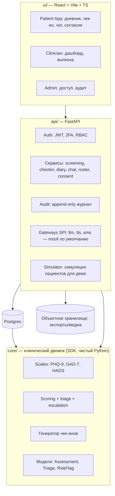

# 03. Архитектура

Статус: v0.1, 2026-10-09. Решения, помеченные [ДОПУЩЕНИЕ], заменимы до начала реализации (этап 05-SDD).

---

## 1. Принципы

1. **Клинический движок = чистый SDK** (ядро без I/O). Вся клиническая логика (шкалы, скоринг, триаж, эскалации, генерация чек-инов) — чистые функции/структуры. Это: (а) максимальная тестируемость (TDD-полигон), (б) бело-брендовый актив для Авинейро — «переиспользуемый движок», (в) переносимость без переписывания.
2. **Порты и адаптеры**: ядро не знает про HTTP/БД/внешние сервисы. API-слой — тонкий адаптер.
3. **Внешние подсистемы (LLM-чат, TTS) — за SPI**, по умолчанию mock-и: демо работает офлайн, нет утечек ПДн в сторонние API.
4. **152-ФЗ конфигурацией**: согласие обязательно; без согласия — только демо-режим без персональных данных. Никакой логики «на усмотрение UI».
5. **Аудит append-only** на уровне БД-инварианта + сервиса.
6. **Демо-истина**: всё, что показываем жюри (дашборд, тренды, эскалации), работает на симуляторе данных реалистичной динамики.
7. Контракты фиксируются до реализации (SDD), реализация — только под красные тесты (TDD).

## 2. Слои и компоненты



## 3. Стек [ДОПУЩЕНИЕ — заменяемо до 05]

| Слой | Выбор | Почему | Замена (если не ок) |
|---|---|---|---|
| Ядро | Python 3.12, чистые типы (dataclass/Protocol), без зависимостей | pydantic-free ядро: мгновенный импорт, 100% юнит-тестируемость, SDK как `pip install` | TypeScript-ядро (если команда JS-only) |
| API | FastAPI + SQLAlchemy 2 + Alembic | автогенерация OpenAPI (контракт → типы UI), быстрая разработка, Pydantic-валидация на границе | NestJS/Express |
| БД | PostgreSQL 16 | 02 §4: <150 RPS, ~0.5 ТБ за 5 лет — Postgres с запасом; JSONB под items | SQLite на демо (не для продуктива) |
| UI | React 18 + Vite + TS + TanStack Query | скорость, экосистема, генерация типов из OpenAPI | — |
| Инфра | docker compose, nginx (TLS), pg_dump cron | 1 узел хватает по нагрузке; минимум операционки для 2 недель | — |
| Внешние | LLM/TTS/SMS за SPI, mock по умолчанию | демо офлайн; no ПДн → внешним API | подключение реальных адаптеров |

## 4. Модули ядра (SDK) — контрактная поверхность

```python
# core/scale.py
class Scale: code, title, items, scoring (пороги severity)
class ScaleResult: total_score, severity, per_item

# core/scoring.py
def score(scale: Scale, answers: dict[str, int]) -> ScaleResult          # чистая
def triage(result: ScaleResult, context) -> Triage                       # GREEN|YELLOW|RED
def risk_flags(scale: Scale, answers) -> list[RiskFlag]                  # суицидальный пункт и пр.

# core/checkin.py
def generate_checkin(scale: Scale, last: ScaleResult | None) -> Checkin  # 2–5 вопросов, фокус на дельте

# core/trend.py
def trends(runs: Sequence[ScaleResult]) -> Trend                          # скользящее среднее, дельта 7/30 дней
```

Детальные сигнатуры и таблицы порогов — в 05-SDD (дизайн) и 06-TDD (тесты). Пороги PHQ-9/GAD-7/HADS — по официальным руководствам, подтверждаются медиком команды.

## 5. Контракты API (сводно; полные схемы — в 04)

| Метод | Путь | Назначение | Роль |
|---|---|---|---|
| POST | `/api/v1/auth/register`, `/login`, `/refresh` | аутентификация (2FA для CLINICIAN/ADMIN) | public |
| POST/GET | `/api/v1/consent`, `POST /consent/revoke` | согласие 152-ФЗ | PATIENT |
| GET | `/api/v1/questionnaires` | каталог шкал | PATIENT, CLINICIAN |
| POST | `/api/v1/screenings` | начать скрининг | PATIENT |
| POST | `/api/v1/runs/{id}/answers` + `/finish` | ответы → assessment | PATIENT |
| POST/GET | `/api/v1/checkins` | ежедневный чек-ин | PATIENT |
| GET | `/api/v1/me/timeline` | тренды пациента | PATIENT |
| POST/GET | `/api/v1/diary` | дневник | PATIENT |
| GET | `/api/v1/clinician/patients?triage=` | список по риску | CLINICIAN |
| GET | `/api/v1/clinician/patients/{id}/report` | выписка-сводка | CLINICIAN |
| POST/GET | `/api/v1/chat/thread` | чат-поддержка | PATIENT |
| GET | `/api/v1/admin/audit?from=&to=` | журнал аудита | ADMIN |
| POST | `/api/v1/admin/roster` | привязка врач→пациент | ADMIN |

Ошибки: RFC 7807 `application/problem+json`; коды: `VALIDATION`, `UNAUTHORIZED`, `FORBIDDEN`, `NOT_FOUND`, `CONFLICT`, `CONSENT_REQUIRED`.

## 6. Сервисные инварианты (проверяются тестами интеграции)

- Ответы принимаются только в открытом `questionnaire_run`; после `/finish` run закрыт (апдейты — 409 CONFLICT).
- `assessment` вычисляется сервером (ядро), клиент не передаёт баллы.
- Чтение медданных пациента — только врач из `clinician_roster` (проверка в сервисе, не в UI).
- Эскалация RED: alert врачу + блок с контактами помощи пациенту в течение 1 с после `/finish` (триггер в транзакции).
- Все обращения к спецкатегориям пишутся в `audit_log` (append-only), включая чтения по roster.
- Без активного согласия PATIENT не может создавать персональные данные (только демо-объекты с флагом `is_demo`).

## 7. Развёртывание (демо и пилот)

- docker compose: `postgres` + `api` + `ui` (nginx: статика + reverse proxy, TLS via Caddy) + `seed` (одноразовый генератор симуляции).
- Резервирование: `pg_dump` daily (крипт. том), retention 30 d + weekly 12 mo — чек-лист включён в демо-прогон.
- Хостинг: РФ (Яндекс/VK Cloud) или on-prem вуза [ДОПУЩЕНИЕ, 152-ФЗ ст. 12 — без трансграничной передачи].
- Секреты: `.env` не в git, ключи — env/KMS; пароли argon2; JWT-ключ ротация.

## 8. Модель угроз (кратко; полная — в файле рисков ГОСТ Р ИСО 14971)

| Угроза | Вектор | Митигация (слой) |
|---|---|---|
| Утечка спецкатегорий | прямой доступ к БД / инъекция | SQLAlchemy-параметризация, шифрование at rest, VLAN, минимальные привилегии |
| Несанкционированный доступ врача | подмена/cookie | 2FA, короткий TTL JWT, roster-проверка в сервисе |
| Пропущенный красный флаг | ошибка логики | TDD-покрытие движка (табличные тесты порогов), тест от «ошибки суицидального пункта» |
| Слив ПДн во внешний API | LLM/TTS | SPI-mock по умолчанию, прокси-сервис без доступа к БД, минимализация payload |
| Подделка аудита | UPDATE журнала | append-only (БД-триггер + сервис), WORM-семантика |
| Социальная инженерия (админ) | 2FA, согласие | 2FA, ролевая матрица, журнал |

## 9. Ёмкость и производительность (из 02 §4)

- API-слой: p95 < 300 мс; эскалация RED < 1 с; скрининг (9–14 вопросов) завершается < 3 мин.
- Индексы: `assessment(patient_id, computed_at DESC)`, `questionnaire_run(patient_id, finished_at DESC)`, `answer(run_id)`, `audit_log(occurred_at)`, `escalation(patient_id, resolved_at)`.
- Один инстанс Postgres + nginx закрывают L2×5 (<150 RPS пик) — масштабирование не входит в MVP-скоуп.

## 10. Стратегия тестирования (передача в 06)

- Пирамида: unit (ядро) ≈ 60, integration (API+БД) ≈ 20, e2e (UI-флоу) ≈ 5.
- Демо-проверка: `seed` симуляция → прогон сценариев питча (скрининг → красный флаг → врач видит каскад 1 экран).
- Никаких тестов «на копирование/мок-эхо»: только поведение контрактов.

## 11. Открытые решения (до 05)

1. Стек по п.3 ок? (Python-ядро + FastAPI + React).
2. Хостинг демо: локально Docker (демо-день — ноутбук) vs облако РФ.
3. Медик команды подтверждает пороги шкал (таблица в 05).