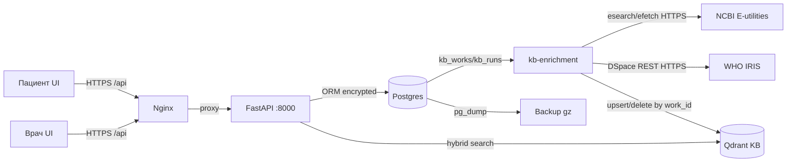

# Модель угроз и реестр рисков (ГОСТ Р ИСО/МЭК 14971-2011, STRIDE)

**Артефакт:** docs/10-модель-угроз.md
**Дата:** 2026-10-19
**Область:** Clinical Compass — цифровой ассистент врача (скрининг тревоги/депрессии)
**Нормативная база:** 152-ФЗ ст.10 (спецкатегория ПДн), ПП РФ №1119 (УЗ-2), ФСТЭК №21, ГОСТ Р 56939-2016, ГОСТ Р ИСО/МЭК 12207-2010, ГОСТ Р ИСО 14971-2011 (менеджмент рисков медицинских изделий), ГОСТ Р МЭК 62304-2013 (ПО медицинских изделий).

---

## 1. STRIDE-анализ по компонентам

| Компонент | S (Spoofing) | T (Tampering) | R (Repudiation) | I (Info Disclosure) | D (DoS) | E (Elevation) |
|-----------|-------------|---------------|-----------------|--------------------| -------| --------------|
| Пациент (UI + API) | фишинг логина; XSS кража токена (F9 mitigated: httpOnly cookies) | подмена ответов скрининга | отрицание отправки дневника | утечка дневника/чата/баллов через SQL-dump | перебор OTP (F4 rate-limit 5/60s; CC_REQUIRE_OTP=true по умолчанию, прод обязателен) | patient→clinician (RBAC: JWT role check) |
| Врач (UI + API) | кража TOTP-секрет (F3: в БД, не в git); XSS (F9 cookies) | подмена назначения шкалы | отрицание чтения карты пациента | доступ к чужому пациенту (IDOR — _require_roster) | — | clinician→admin (RBAC) |
| API (FastAPI/uvicorn) | JWT-форжинг (F3: prod_mode fail-fast); replay refresh (F4: jti+rotation) | инъекция в seed (F10: parameterized); pydantic bypass | отсутствие аудита (F6: patient self-reads audited) | plaintext ПДн в БД (F1: pgcrypto); 422 echo PHI (F5: stripped) | rate-limit обход (IP spoofing via X-Forwarded-For) | role escalation через JWT tampering (HS256, secret >=32) |
| Postgres | — | TRUNCATE audit (trg_audit_no_truncate); DROP TABLE | audit_log append-only trigger | прямой доступ к ПДн (F1: free-text encrypted; numeric plaintext) | — | — |
| Qdrant | — | — | — | corpus не содержит ПДн (docs/08: engine content + ГРЛС facts) | — | — |
| nginx | — | — | логи URI с patient UUID (F12: no URI in access_log) | — | — | — |
| Docker Compose | — | — | — | api:8000 прямой доступ (F12: expose only, no host port) | — | — |
| kb-enrichment + внешние источники (NCBI, IRIS) | подмена ответа внешнего API (TLS, фиксированный base URL) | подмена текста/ретракции на стороне источника | отрицание ручного approve/reject (`KB_SOURCE_*` audit) | утечка `CC_ENRICH_PUBMED_API_KEY`; ПДн в ответах PubMed отсутствуют по контракту (абстракты статей, а не данные пациентов) | rate-limit/бан NCBI при частых прогонах (интервал, батчи, `tool`+`email` в User-Agent) | доступ к approve/reject только ADMIN; источник не участвует в выдаче до `approved` |
| ЕМИАС-интеграция (`api/app/emias`, внешний контур) | подмена OAuth-сервера/клиента (client_credentials; секрет вне git, Basic только по https; мок — исключение) | подмена ответов FHIR (TLS-пиннинг на периметре; клиент не следует redirect; валидация Bundle) | отрицание запуска синхронизации (`EMIA_SYNC`/`EMIA_LINK` audit, `emias_sync_runs`) | токен/ПДн в логах (логируется только путь без query; тела не логируются); утечка СНИЛС (хранится только sha256+перец) | отказ/деградация ЕМИАС (таймауты, 3 попытки, `status=failed/partial`, savepoints) | только ADMIN (`POST /admin/emias/*`); egress off by default (`CC_EMIAS_ENABLED=false`) |

---

## 2. Реестр рисков (ГОСТ Р ИСО 14971-2011)

| ID | Опасность (hazard) | Причина | Последствие | P×S | Митигация | Остаточный риск |
|----|-------------------|---------|-------------|-----|-----------|-----------------|
| R1 | Утечка свободного текста ПДн (дневник/чат/НЯ/приверженность/резолюция/сообщения и заголовки тредов ассистента) | Доступ к БД (dump, backup, консоль) | Раскрытие PHI пациента | 2×5=10 | F1: pgcrypto pgp_sym_encrypt (7 колонок, включая `assistant_threads.title` и `assistant_messages.content` — FR-21); F7: backup gzipped | LOW — числовые баллы plaintext (не free-text) |
| R2 | Кража access-токена через XSS | JS-инъекция в UI | Доступ к ПДн от имени пациента | 2×4=8 | F9: httpOnly cookies (токен недоступен из JS); SameSite=Lax | VERY LOW — токен не в localStorage |
| R3 | Кража refresh-токена | Перехват, XSS, кража устройства | 7-дневный доступ | 2×4=8 | F4: server-side jti, ротация при использовании, /logout; F9: httpOnly cookie | LOW — concurrent race (with_for_update); no family revocation |
| R4 | JWT-форжинг через демо-секрет | Деплой compose as-is в prod | Полный auth bypass | 1×5=5 | F3: inverted fail-fast — демо-секреты запрещены всегда, если не CC_ALLOW_DEMO_SECRETS | VERY LOW — Settings() падает при импорте |
| R5 | Несанкционированный доступ к чужому пациенту (IDOR) | Подмена patient_id в path | Чтение PHI чужого пациента | 2×5=10 | _require_roster на всех patient-scoped endpoints; patient_id из JWT не path | NONE — re-audit подтвердил clean |
| R6 | Отсутствие уничтожения ПДн при отзыве согласия | Consent /revoke только флаг | Нарушение 152-ФЗ ст.9 ч.2-3 | 1×4=4 | F2: DELETE всей спецкатегории + push-токенов | NONE |
| R7 | SQL-инъекция | f-string SQL в seed | Выполнение произвольного SQL | 1×3=3 | F10: parameterized text() bind params | NONE |
| R8 | Утечка PHI в логах/ошибках | pydantic echo input; nginx URI логи | Раскрытие дневника/пароля | 2×2=4 | F5: 422 strip input/ctx; F12: access_log без URI | LOW — application logs могут содержать stack traces |
| R9 | П потеря данных при сбое | Нет backup | Утрата всех ПДн | 1×5=5 | F7: tools/backup.sh (pg_dump gz, 30d retention), restore.sh | LOW — нет автоматического cron в демо |
| R10 | Ложный/пропущенный RED флаг | Ошибка в triage/risk_flags | Суицидальный риск не замечен вовремя | 2×5=10 | Эскалация в транзакции <1s; SUICIDAL_IDEATION → RED всегда; routing REQUIRED | LOW — пороги [TBD: подтвердить медиком] |
| R11 | Несанкционированная диагностика/назначение | LLM выходит за red line | Вред пациенту от авто-диагноза | 1×5=5 | detect_redline: REDLINE_DIAGNOSIS/TREATMENT; 323-ФЗ ст.36.2 red line | VERY LOW — нет LLM в loop (deterministic RAG) |
| R12 | Утечка ключа шифрования | pg_stat_activity во время миграции | Расшифровка всех ПДн | 1×4=4 | NEW-3: одноразовая миграция, maintenance window; runtime: bind param | LOW — ключ в env, не в git |
| R13 | Индексация текста без права использования | автоприём гайдлайнов, у которых лицензия не подтверждена | Нарушение авторских прав ВОЗ/журнала | 1×4=4 | вердикт критерия `license` (`CC BY-NC-SA 3.0 IGO` в тексте) + `CC_ENRICH_AUTO_PUBLISH_GUIDELINES`; `All rights reserved` → `not_met`, approve заблокирован | LOW — 2 гайдлайна ВОЗ остаются кандидатами до письменного разрешения |
| R14 | Отравление КБ недостоверной/нерелевантной публикацией | автоматический приём статей из PubMed | Ответ агента с опорой на мусор | 3×3=9 | статьи только `candidate` → approve ADMIN (Кирилл/Марк); жёсткие критерии (ретракция, тема, свежесть, дизайн) блокируют approve; каждый вердикт несёт цитату-подстроку | LOW — ограниченная пропускная способность ревьюеров |
| R15 | Автоматизированная оценка качества принимается за валидированную | AMSTAR 2 по одному абстракту | Ложная уверенность в методологии | 2×3=6 | `experimental=true`, `overall=critically_low` при abstract-only, `manual_review`/`manual_review_reason`, дисклеймер в docs/15 §7 | LOW — оценка не выводится пациенту |
| R16 | Отказ внешнего API останавливает обогащение | сетевой сбой/бан NCBI/IRIS | КБ не пополняется | 2×2=4 | `kb_runs` с `status=failed/partial`, per-document savepoints, таймауты, интервал прогонов, `CC_ENRICH_OFFLINE` | LOW — деградация без влияния на выдачу |
| R20 | Раскрытие контактов пациента (телефон, дата рождения) через общий экран/плечевой просмотр | Врач открыл карточку на общем мониторе; полный номер в списке пациентов | Идентификация пациента сторонними (ФИО + телефон/ДР) | 2×3=6 | FR-22: в списке и карте только маска `+7•••123-45-67`; полный номер — отдельный endpoint с аудитом `READ_PATIENT_CONTACTS`; телефон в БД — pgcrypto; без активного согласия контакты не отдаются (`CONSENT_REQUIRED`), отзыв согласия обнуляет поля | LOW — маска всё же раскрывает 7 последних цифр; UI-подсказка о приватном экране не реализована |

---

## 3. DFD (Data Flow Diagram)

---

## 4. Принятые остаточные риски (demo-accepted)

| Риск | Причина принятия | Prod-путь |
|------|-----------------|-----------|
| Числовые баллы ПДн plaintext | Не free-text; pgcrypto на int не применяется | TDE (LUKS/pgcrypto на уровне таблиц) |
| localStorage токены в native APK | Capacitor cross-origin; httpOnly cookie не работает | Перевести native на WebView same-origin |
| Family/chain revocation | Sequential refresh sufficient for MVP; rate-limited | OAuth token family tracking |
| Backup cron не автоматизирован | Демо одноразовое; manual tools/backup.sh | systemd timer + S3 sync |
| Threat model — структурный артефакт | Данный документ восполняет (F11) | Регулярный пересмотр при изменении архитектуры |
| Внешний текст под CC BY-NC-SA | Некоммерческое использование продукта; условие лицензии ВОЗ | Платный пилот — только с разрешения ВОЗ или заменой источника |
| Автооценка методологии (AMSTAR 2 по абстракту) | Требует полного текста для валидности; храним абстракт | Полные тексты по подписке/PMC OA + двойное ревью |
| ЕМИАС-мок ≠ реальный контур | В демо нет mTLS/ГОСТ-TLS, СМЭВ, НСИ, ЭЦП | Пилот: интеграция через шлюз УЗ-2, аттестация канала, договор с оператором ЕМИАС |
| Хэш СНИЛС с перцем из `CC_DATA_KEY` (если перец не задан) | Демо-упрощение | Прод: отдельный `CC_EMIAS_SNILS_PEPPER` из KMS |
| СНИЛС уходит в query внешнего API (`?identifier=...`) | Контракт FHIR-сервера; TLS-канал | Прокси/shielding УЗ-2 с запретом логирования query + аудит доступа к контуру |
| СНИЛС может остаться в истории shell при `cli link <id> <СНИЛС>` | Совместимость; предпочтительны `CC_EMIAS_SNILS`/stdin | Убрать argv-форму, только env/stdin |
| Fallback-связка по ФИО при отсутствии СНИЛС | Демо-упрощение, только уникальное совпадение | Прод: связка только по СНИЛС/полису через оператора |

---

## 5. Соответствие ГОСТ

| ГОСТ | Требование | Артефакт |
|------|-----------|----------|
| ГОСТ Р 56939-2016 | Безопасная разработка | docs/05-SDD, tools/ci.sh, uv.lock |
| ГОСТ Р ИСО/МЭК 12207-2010 | Жизненный цикл ПО | docs/01-15, git history |
| ГОСТ Р ИСО 14971-2011 | Менеджмент рисков | **docs/10 (этот документ)** — реестр R1-R19 |
| ГОСТ Р МЭК 62304-2013 | ПО медицинского изделия | MVP не регистрируется как ИМН; класс B при decision support — path documented |
| 152-ФЗ ст.10 | Шифрование спецкатегории | F1: pgcrypto на free-text ПДн |
| 152-ФЗ ст.9 ч.2-3 | Уничтожение при отзыве | F2: DELETE всей спецкатегории |
| ПП РФ №1119 | УЗ-2 защищённость | F1+F3+F4+F7; audit append-only |
| ФСТЭК №21 | ИАФ, защита инф. системы | F3 fail-fast, F8 lockfile, F6 audit IP |
